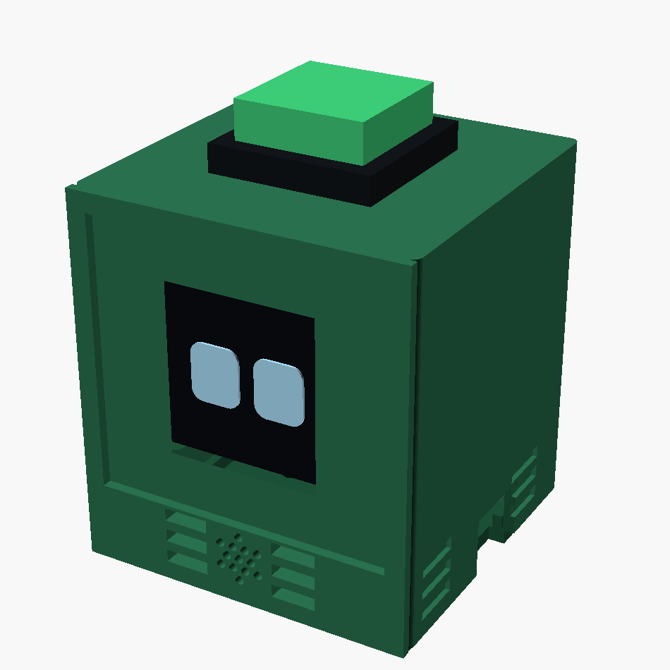

# Gluon

*[English](README.md) · Français*

Un réveil-compagnon sur ESP32, avec des yeux animés, dans un boîtier imprimé en 3D.

## Ce qu'il fait

- **Réveil :** jours de la semaine, snooze, lever progressif et douze sonneries, dont six airs du domaine public.
- **Compagnon :** des yeux animés, six humeurs, et quelques mots le matin selon la météo et ta journée.
- **Connecté :** météo sans compte via Open-Meteo, agenda Google en option, messages à l'écran.
- **Interface web :** tout se règle depuis `http://gluon.local`.
- **Mises à jour sans fil :** après le premier téléversement par câble.

## Le matériel

| Élément | Modèle |
|---|---|
| Carte | ESP32 DevKit 30 broches |
| Écran | Waveshare 1,5" RGB OLED, SSD1351, 128 × 128 |
| Son | Ampli I2S MAX98357A et haut-parleur 16 Ω |
| Bouton | Bouton d'arcade lumineux 22 mm, LED 5 V |
| Boîtier | Imprimé en 3D, 68 × 68 × 75 mm |

## Démarrer

1. Imprime le boîtier : [`cao/stl/`](cao/stl/).
2. Câble l'ensemble en suivant le [guide de montage](docs/MONTAGE.md).
3. Dans `firmware/gluon/`, copie `config.example.h` en `config.h`, puis remplis-le.
4. Compile avec le schéma de partition **Minimal SPIFFS** et téléverse par câble.

## Le contenu

| Dossier | Rôle |
|---|---|
| [`firmware/gluon/`](firmware/gluon/) | le programme de l'ESP32 et ses animations (`anim_*.h`, facultatives : retire-les si le programme est trop gros) |
| [`agenda/`](agenda/) | le script Google facultatif pour l'agenda |
| [`cao/`](cao/) | le boîtier : source OpenSCAD paramétrique et fichiers STL |
| [`docs/`](docs/) | le montage, l'utilisation et le dépannage |

## Sécurité

- **Interface web :** elle n'a pas de mot de passe. N'importe qui sur ton réseau local peut la commander, alors ne l'expose jamais sur Internet.
- **Connexions :** le réseau de secours et les mises à jour sans fil utilisent les mots de passe que tu choisis dans `config.h`.

## Licences

Le code est sous [licence MIT](LICENSE), le boîtier sous [CC BY 4.0](cao/LICENSE.md).

## Support

Je partage ce projet tel quel, sans promettre d'assistance. C'est un projet personnel : à toi de l'adapter.
