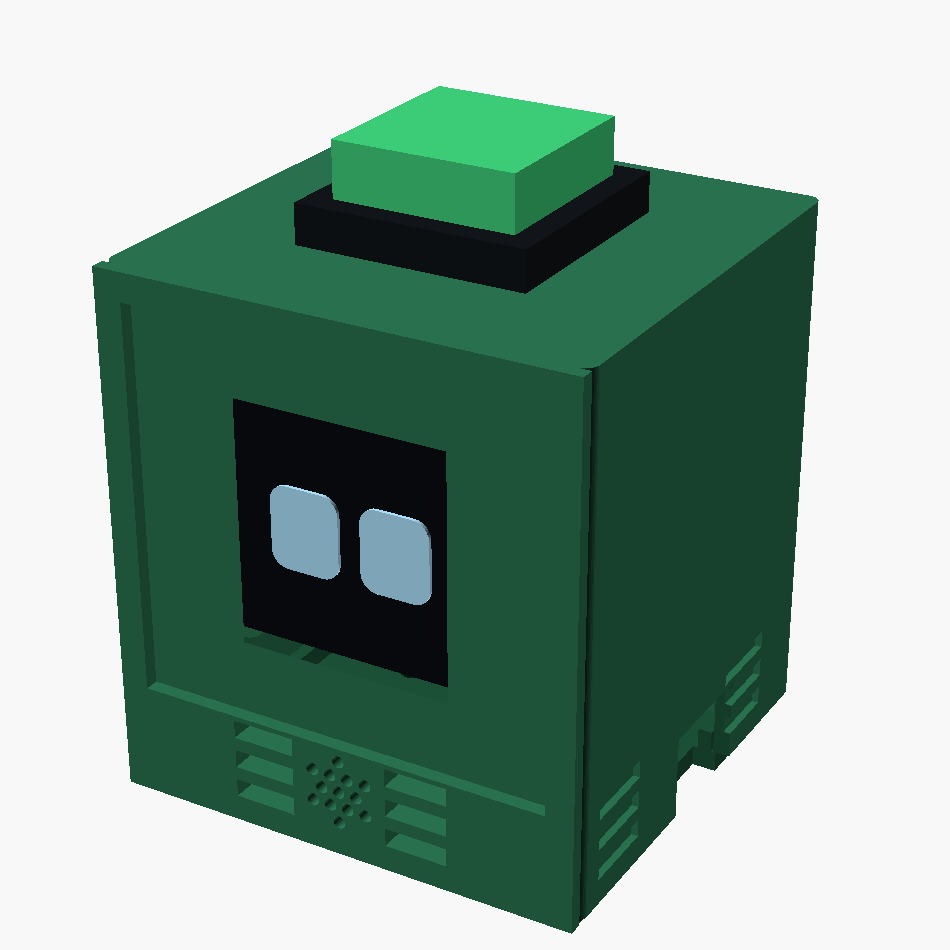

# Gluon

*English · [Français](README.fr.md)*

An ESP32 desk companion and alarm clock with animated eyes, in a 3D-printed case.

## Features

- **Alarm clock:** weekdays, snooze, gradual wake-up light and twelve ringtones, six of them public-domain tunes.
- **Companion:** animated eyes, six moods, and a few words in the morning based on the weather and your day.
- **Connected:** weather with no account via Open-Meteo, optional Google Calendar, messages on screen.
- **Web interface:** everything is set from `http://gluon.local`.
- **Over-the-air updates:** after the first upload over USB.

The on-screen text and the web interface are in French.

## Hardware

| Part | Model |
|---|---|
| Board | ESP32 DevKit, 30 pins |
| Display | Waveshare 1.5" RGB OLED, SSD1351, 128 × 128 |
| Sound | MAX98357A I2S amplifier and 16 Ω speaker |
| Button | 22 mm illuminated arcade button, 5 V LED |
| Case | 3D-printed, 68 × 68 × 75 mm |

## Getting started

1. Print the case: [`cao/stl/`](cao/stl/).
2. Wire everything following the [assembly guide](docs/MONTAGE.md) (French; the pin tables are easy to follow).
3. In `firmware/gluon/`, copy `config.example.h` to `config.h` and fill it in.
4. Build with the **Minimal SPIFFS** partition scheme and upload over USB.

Libraries: Adafruit GFX, Adafruit SSD1351, ArduinoJson v7 (Arduino library manager).

## Contents

| Folder | Purpose |
|---|---|
| [`firmware/gluon/`](firmware/gluon/) | ESP32 firmware and its animations (`anim_*.h`, optional: remove them if the program is too large) |
| [`agenda/`](agenda/) | optional Google Apps Script for the calendar |
| [`cao/`](cao/) | the case: parametric OpenSCAD source and STL files |
| [`docs/`](docs/) | assembly, usage and troubleshooting |

## Security

- **The web interface has no password.** Anyone on your local network can control it, so never expose it to the Internet.
- **Fallback Wi-Fi and OTA updates** use the passwords you set in `config.h`.

## License

Code under the [MIT license](LICENSE), case under [CC BY 4.0](cao/LICENSE.md).

## Support

Shared as is, with no promise of support. It's a personal project: adapt it to your needs.
