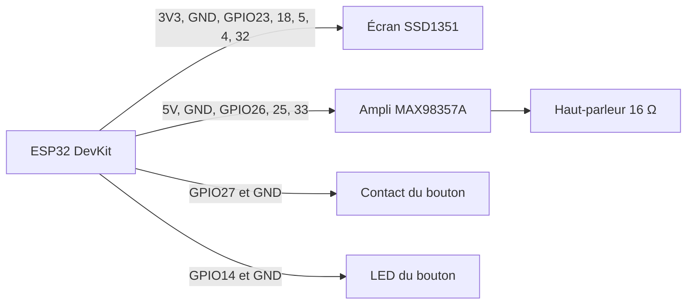

# Montage et utilisation

Pour le firmware **v15**, affiché dans l'interface sous le titre.

## 1. Le câblage

**Écran OLED**, cavalier BS au dos sur **0**

| Module | ESP32 |
|---|---|
| VCC | 3V3 |
| GND | GND |
| DIN | GPIO23 |
| CLK | GPIO18 |
| CS | GPIO5 |
| DC | GPIO4 |
| RST | GPIO32 |

**Ampli MAX98357A**

| Module | ESP32 |
|---|---|
| Vin | 5V |
| GND | GND |
| BCLK | GPIO26 |
| LRC | GPIO25 |
| DIN | GPIO33 |
| GAIN | GND, soit 12 dB |
| SD | **laisser en l'air** |

Le haut-parleur va sur le bornier à vis, sens indifférent, sans résistance.

**Bouton d'arcade**, cosses 4,8 mm pour le contact, 6,3 mm pour la LED

| Fil | Destination |
|---|---|
| Contact | GPIO27 et GND |
| LED | GPIO14 et GND |

Prévois un condensateur de **470 µF** entre le 5 V et la masse, au plus près de l'ESP32.

## 2. Le boîtier

| Fichier | Impression |
|---|---|
| `cao/stl/gluon_coque.stl` | ouverture vers le plateau, sans support |
| `cao/stl/gluon_socle.stl` | à plat |
| `cao/gluon_boitier.scad` | source paramétrique, à ouvrir avec OpenSCAD |

Avant d'imprimer, mesure l'épaisseur du verre de ton écran et règle `verre_ep` dans le `.scad` si besoin. La valeur par défaut est 2 mm.

Pour exporter une pièce, règle `piece` sur `"coque"` ou `"socle"`.

## 3. Le firmware

**Bibliothèques**, à installer depuis le gestionnaire de bibliothèques de l'IDE Arduino :

- **Adafruit GFX Library**
- **Adafruit SSD1351 library**, en acceptant les dépendances
- **ArduinoJson**, version 7

**Configuration :** dans `firmware/gluon/`, copie `config.example.h` en `config.h`, remplis-le, puis supprime la ligne `#error`. Le Wi-Fi doit être en 2,4 GHz.

**Menu Outils :**

| Réglage | Valeur |
|---|---|
| Carte | ESP32 Dev Module |
| Partition Scheme | **Minimal SPIFFS (1.9MB APP with OTA)** |
| Port | ton port COM, pour le premier téléversement |

**Le premier téléversement se fait par câble.** Ensuite, `gluon` apparaît dans **Outils → Port → Ports réseau**, avec le mot de passe `OTA_PASS` choisi dans `config.h`.

Si le Wi-Fi ne répond pas, Gluon crée son propre réseau **Gluon**, accessible sur `192.168.4.1` avec le mot de passe `MDP_AP`.

## 4. L'agenda Google, facultatif

1. Sur `script.google.com`, crée un **nouveau projet**.
2. Colle le contenu de `agenda/agenda_apps_script.gs` et renomme le projet `gluon-agenda`.
3. Choisis **Déployer → Nouveau déploiement → Application web**.
4. Règle *Exécuter en tant que* sur **Moi** et *Qui a accès* sur **Tout le monde**.
5. Autorise l'accès à l'agenda. Pour un script personnel, Google affiche un avertissement : passe par *Paramètres avancés*.
6. Copie l'URL, qui finit par **`/exec`**, dans `AGENDA_URL`.

**Cette URL doit rester secrète :** qui la possède peut lire l'heure et le titre de tes six premiers rendez-vous du jour.

Si tu modifies le script, refais un **nouveau** déploiement, sinon l'ancienne version continue de tourner.

## 5. L'utilisation

| Situation | Appui court | Appui long |
|---|---|---|
| Normal | change d'écran, visage ou infos | veille |
| Il te parle | phrase suivante | veille |
| Animation en cours | coupe l'animation | veille |
| Message affiché | efface le message | veille |
| Ça sonne | snooze | arrêt |

L'interface web est sur `http://gluon.local`. Si le nom ne répond pas, utilise l'adresse IP affichée dans le moniteur série à 115200 bauds.

Gluon fait aussi plusieurs choses tout seul :

- **La nuit :** écran noir et LED en veilleuse.
- **Avant l'alarme :** dégradé chaud et LED qui monte.
- **Après l'alarme :** il donne l'heure, la météo et l'agenda, puis un mot pour la journée.
- **En continu :** météo et agenda sont rafraîchis toutes les 30 minutes.

**Les sonneries** sont en clair dans `gluon.ino`, en couples note-durée. Un zéro en fréquence est un silence.

**Les mots du matin** sont dans le tableau `MOTS[]`. Écris-les **sans accents** : la police embarquée ne gère que l'ASCII.

## 6. Les animations, facultatives

Le firmware sait afficher de courtes animations, mais **aucune n'est fournie ici**. Il prend en compte tout seul les fichiers `anim_cfc.h`, `anim_fission.h`, `anim_bragg.h` et `anim_orbitales.h` s'ils sont dans le dossier du `.ino`. Sans eux, il fonctionne normalement et la section Animations de l'interface reste vide.

Reste sous 90 % de flash : les mises à jour sans fil ont besoin de place pour écrire la nouvelle version à côté de l'ancienne.

## 7. Le dépannage

| Symptôme | Cause probable |
|---|---|
| `config.h manquant` | copie `config.example.h` en `config.h` |
| « Sketch too big » | Partition Scheme n'est pas sur Minimal SPIFFS |
| Redémarrage en boucle, `Brownout` | alimentation : chargeur d'au moins 1 A, condensateur 470 µF |
| `Failed to connect to ESP32` | maintiens **BOOT** pendant « Connecting… », baisse Upload Speed à 115200, ferme le moniteur série |
| Écran noir | cavalier BS, ou broches DC et RST |
| Un seul « ploc » puis silence | flux I2S coupé, vérifie DIN sur GPIO33 |
| Son trop faible | GAIN sur GND, volume à 90 dans l'interface |
| « PAS D'HEURE » en orange | pas de NTP, donc **l'alarme ne partira pas** |
| L'interface dit « hors ligne » alors que Gluon répond | cache du navigateur : Ctrl+F5 ou onglet privé |
| Météo absente | vérifie `LAT`, `LON` et l'accès à Internet |

**Pour tout diagnostiquer,** ouvre `http://gluon.local/state`. Si une ligne de JSON s'affiche, Gluon va bien et le problème vient du navigateur.

## 8. Ce qui reste à faire

- **Horloge DS3231 :** garder l'heure sans réseau ni courant. Le code reste à écrire.
- **Webradio :** se réveiller sur une vraie station.
